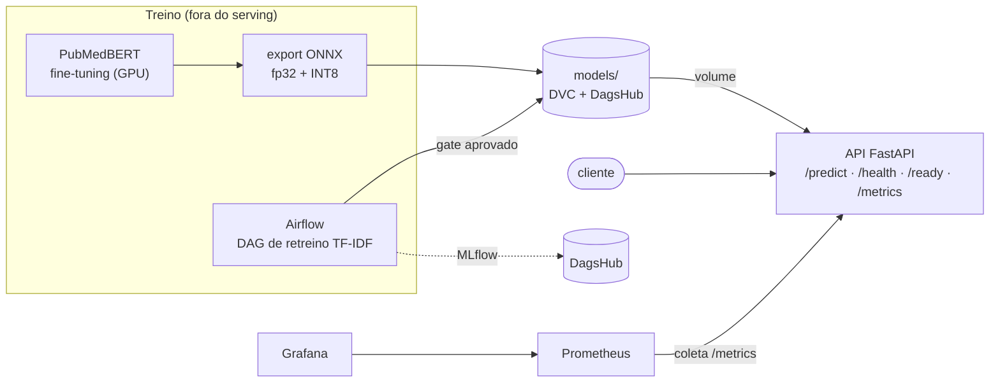

# Triagem de laudos médicos — Tech Challenge Fase 03

Classificador de texto médico servido por API, com CI/CD, retreino orquestrado, monitoramento e otimização de latência.  
Projeto desenvolvido para o Tech Challenge da Fase 03 da Pós Tech ML Engineering - FIAP.

**Autor:** Alessandro Stefani  
**Modelo servido:** PubMedBERT com fine-tuning, exportado para ONNX e quantizado (INT8); TF-IDF + Regressão Logística como alternativa leve. Dados versionados em DVC, experimentos no MLflow (DagsHub) e serviços em Docker.  
**Dataset:**  
&emsp;[*Evaluating Unsupervised Text Classification: Zero-shot and Similarity-based Approaches*](https://doi.org/10.1145/3582768.3582795) — Schopf, Braun & Matthes (2023)  
&emsp;[*Medical Abstracts Text Classification Dataset - Hugging Face*](https://huggingface.co/datasets/TimSchopf/medical_abstracts)  
&emsp;Licença [CC BY-SA 3.0](https://creativecommons.org/licenses/by-sa/3.0/)

[]()
[]()
[]()
[]()
[]()
[]()
[]()


> 🎥 **Vídeo de apresentação (5 min):** <https://youtu.be/g3nmRH0o2IA>  
> 📊 **Experimentos (MLflow):** <https://dagshub.com/Astefani/tc-fiap-fase03-triagem.mlflow>  
> 💾 **Repositórios:**  
&emsp;&emsp;GitHub - <https://github.com/Astefani/tc-fiap-fase03-triagem/>  
&emsp;&emsp;DagsHub - <https://dagshub.com/Astefani/tc-fiap-fase03-triagem/>


## Problema

Classificar o texto de um laudo em 5 categorias de condição (neoplasias, digestivas, nervosas, cardiovasculares e
condições patológicas gerais), com resposta rápida o suficiente para uso em triagem.

## Resultados

| Modelo | F1-macro no teste¹ | Acerto por resumo² | Latência p50 | Tamanho |
|---|---|---|---|---|
| TF-IDF + Regressão Logística | 0,7767 | 0,8780 | 0,54 ms | 4 MB |
| PubMedBERT (original, PyTorch) | — | — | 90,6 ms | 418 MB |
| PubMedBERT ONNX fp32 | 0,8103 | 0,9007 | 83,8 ms | 418 MB |
| **PubMedBERT ONNX INT8 (servido)** | **0,8127** | **0,9014** | **33,7 ms** | **105 MB** |

¹ Textos do teste oficial que não aparecem no treino (1.878 linhas). Ver [Avaliação](#avaliação).
² A classe prevista está entre as condições verdadeiras do resumo (teste oficial completo).

- **Otimização:** INT8 é **2,7× mais rápido** que o modelo original, com −0,3 pt de F1 e modelo 4× menor.
  Detalhes e protocolo em [`docs/latencia.md`](docs/latencia.md).
- **Escolha do modelo:** feita na validação, antes de tocar no teste. O BERT venceu a LogReg com +2,5 pt em F1-macro.
No teste oficial, a vantagem se confirmou e atingiu +3,6 pt nos textos novos (que não estavam no treino).

## Arquitetura local



- **API:** um backend por processo, escolhido por `TRIAGEM_MODEL_BACKEND` (`bert-onnx-int8` padrão, `bert-onnx`,
  `tfidf-logreg`), com o modelo entrando por volume.
- **Retreino:** a DAG renova o **TF-IDF** (backend alternativo): `verificar_dados → treinar → avaliar → gate → publicar`.
  O candidato só substitui o TF-IDF publicado se for melhor (F1) ou igual e mais rápido (p95). Se for reprovado, a task
  `publicar` fica com status *skipped*. O BERT, servido por padrão, é retreinado fora do Airflow, porque o fine-tuning
  exige GPU.
- **Monitoramento:** Prometheus + Grafana provisionados (sobem prontos). Painéis de tráfego, erros, latência,
  inferência por backend, classes previstas e tamanho do texto (para monitoramento de drift).
- **CI:** lint → testes → build da imagem + smoke test do container (usando uma amostra versionada, sem DVC e credenciais).

## Arquitetura em nuvem

- **Real-time:** triagem pede resposta síncrona.
- **Serving:** container gerenciado (AWS ECS Fargate), imagem no registry (ECR) publicada pelo CI.
- **Escala:** Instâncias x86 usando escala horizontal baseada em CPU e/ou latência, com uma instância mínima sempre ativa (sem cold start)
- **Modelo:** artefato versionado em object storage (S3), referenciado pelo ponteiro DVC do commit em produção.
- **Retreino:** Airflow gerenciado via MWAA, mesma DAG.
- **Observabilidade:** Prometheus e Grafana gerenciados (ou CloudWatch), alertas de latência e taxa de erro.
- **LGPD (dado de saúde, art. 11):** rede privada, TLS, credenciais num gerenciador de segredos, dados na região
  São Paulo e **o texto do laudo nunca vai para log nem métrica**.

## Decisões principais

- **F1-macro como métrica principal:** as 5 classes pesam igual.
- **Acerto por resumo como complemento:** O dataset é multirrótulo, com o mesmo texto aparecendo em mais de uma condição.
Devido a isso, prever uma das condições corretas conta como erro nas outras linhas do mesmo resumo.
- **Validação agrupada por texto:** o mesmo resumo nunca fica em treino e validação.
- **Teste oficial usado uma vez**, no fim, só para medir.
- **TF-IDF mantido** como backend leve e como o modelo que o retreino automático atualiza.
- **Proveniência:** cada artefato grava o hash dos dados, o commit e se o código era idêntico ao commit; métricas
  e parâmetros vão para o MLflow (DagsHub).

## Avaliação

No dataset, 35% das linhas do teste repetem um texto do treino **com outro rótulo**. Nelas, os modelos tendem a
prever o rótulo que viram no treino: erram a linha, mas acertam uma condição verdadeira do resumo. Por isso o
resultado vem separado:

| | TF-IDF + LogReg | BERT fp32 | BERT INT8 |
|---|---|---|---|
| F1 na validação | 0,6649 | 0,6967 | 0,6918 |
| F1 no teste, total (2.888) | 0,5616 | 0,6433 | 0,6473 |
| F1 no teste, textos novos (1.878) | 0,7767 | 0,8103 | 0,8127 |
| F1 no teste, textos vistos no treino (1.010) | 0,1809 | 0,3487 | 0,3557 |
| Acerto por resumo, total | 0,8780 | 0,9007 | 0,9014 |

O F1 dos textos novos fica acima da validação porque só 10% dessas linhas vêm de resumos com várias condições
(35% na validação), e nelas o F1 por linha tem teto. O acerto por resumo, que não tem esse teto, fica estável
(0,84 na validação, 0,86 nos textos novos).

## Como rodar

Pré-requisitos: Python 3.12, [Poetry](https://python-poetry.org/) 2.x, Docker com Compose e uma conta gratuita
no [DagsHub](https://dagshub.com).

**Credencial para baixar dados e modelo.** O DagsHub exige login para o `dvc pull`, mesmo com o repositório
público:

1. Crie uma conta em [dagshub.com](https://dagshub.com/user/sign_up) — dá para entrar direto com a conta do
   GitHub (*Sign up with GitHub*).
2. Gere um token em [*Settings → Tokens*](https://dagshub.com/user/settings/tokens) e copie.
3. Depois do `poetry install`, grave o token como chave e segredo do remote (fica só na sua máquina, em
   `.dvc/config.local`, fora do Git):

```bash
poetry run dvc remote modify --local origin access_key_id     <SEU_TOKEN>
poetry run dvc remote modify --local origin secret_access_key <SEU_TOKEN>
```

Os experimentos no [MLflow](https://dagshub.com/Astefani/tc-fiap-fase03-triagem.mlflow) podem ser vistos sem login.

**Execução:**

```bash
git clone https://github.com/Astefani/tc-fiap-fase03-triagem.git && cd tc-fiap-fase03-triagem
poetry install                      # main + dev
# configurar o token (passo 3 acima)
poetry run dvc pull                 # dados e modelo BERT (DagsHub)
poetry run pytest                   # testes

docker compose up -d                # API :8000/docs · Prometheus :9090 · Grafana :3000
poetry run python scripts/load_gen.py   # tráfego para o dashboard

docker compose --profile airflow up -d  # Airflow :8080 → disparar a DAG triagem_retreino
```

- TF-IDF: gerado pelo retreino. Rodar a DAG uma vez ou `poetry run python -m triagem.train retreinar`.
- Latência: `poetry run python scripts/bench_latency.py inprocess` (protocolo em [`docs/latencia.md`](docs/latencia.md)).
- Avaliação no teste oficial: `poetry run python scripts/avaliar_teste.py`.
- Treino do BERT (GPU): `poetry install --with train` → `python -m triagem.bert_train` → `python -m triagem.bert_export`.
- MLflow (opcional): copiar `.env.example` para `.env` e preencher as credenciais do DagsHub.

## Limitações

- Resumos de artigos em inglês, não laudos reais; a categoria é a condição, não a urgência clínica.
- Classificador de rótulo único sobre dado multirrótulo: teto de desempenho por linha.
- A classe *general pathological conditions* é a mais fraca (F1 0,50 no teste): é uma categoria "resto", sem
  vocabulário próprio.
- O ganho do INT8 depende da CPU (2,5× sobre o fp32 em x86, 1,2× num Apple M4), e a qualidade também varia
  levemente (F1 0,6918 em x86, 0,6879 em ARM).
- Drift monitorado por sinais simples (classes previstas e tamanho do texto), sem alertas automáticos.
- O gate compara versões do mesmo modelo (TF-IDF novo × TF-IDF publicado), não o candidato com o modelo servido.
  Trocar o modelo servido continua sendo uma decisão manual (variável `TRIAGEM_MODEL_BACKEND`).

## Trabalhos futuros

- Modelar a classe "geral" como rejeição (prever *general* quando nenhuma classe específica tem confiança) ou
  tratar o problema como multirrótulo de fato.
- Calibração de probabilidades; destilação para um modelo menor.
- Champion/challenger entre modelos: retreinar o BERT no pipeline e promover para produção o melhor candidato, com
  um alias de produção (Model Registry).
- Alertas de drift.

## Estrutura

```
src/triagem/      pacote: dados, treino, avaliação, gate, preditor, API, métricas
airflow/dags/     DAG de retreino
docker/           Dockerfile da API e do Airflow
monitoring/       Prometheus e Grafana (provisioning + dashboard)
scripts/          benchmark de latência, gerador de carga, avaliação no teste, amostra
tests/            testes (rodam no CI com a amostra versionada)
notebooks/        EDA e comparação de modelos
docs/             latência, avaliação, prints
```